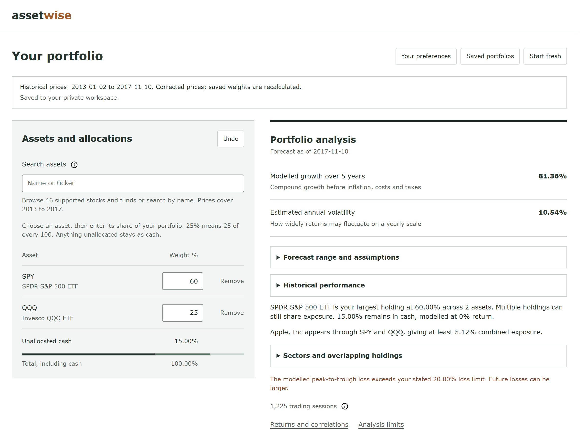
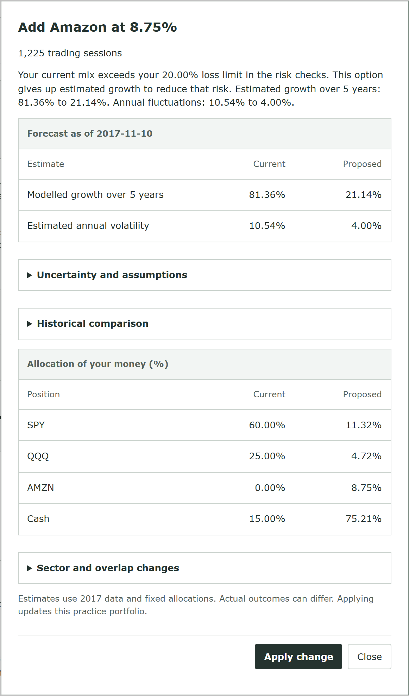

# assetwise

## See what a change could mean for your money.

Build a portfolio, understand its risks and compare your next move.

[Run Assetwise locally](#run-locally) | [How it works](#from-an-idea-to-a-comparison) | [Under the hood](#under-the-hood)



Two funds can own the same companies. Assetwise shows where your holdings overlap, alongside estimated growth and potential losses.

## From an idea to a comparison

Start with what you know. Pick familiar assets from **46 stocks and funds**, then decide how much to put in each. Use your own holdings or try a completely new mix.

A short survey sets your goal, investment period and comfort with losses. Beginners get explanations beside the numbers, with more detail a click away. Experienced investors get a more compact view.

Change an allocation and the analysis updates. Assetwise checks alternatives against your preferences and shows **up to three changes to consider**. Open a preview to see what you would gain, what you would give up and where your money would move.

<p align="center">
  
</p>

Lower risk can come with lower estimated growth. The preview explains that trade-off before you apply anything.

Keep the version you like. Undo an edit, save several portfolios or export a backup to return to later. Everything happens in a practice workspace; Assetwise places no trades.

**The data:** real historical prices from January 2013 to November 2017. Forecasts use that archive as their starting point. This version is for exploring portfolio decisions with dated data; it has no live market feed.

## Under the hood

Python and FastAPI handle the calculations and API. SQLite stores portfolios and preferences. The interface uses plain HTML, CSS and JavaScript, with no frontend build step.

### Run locally

Requirements: **Python 3.14**; **Node.js** for frontend tests. Historical data is bundled. No market-data API key or separate database service is required.

From the repository folder on Windows:

```powershell
python -m venv .venv
.\.venv\Scripts\python.exe -m pip install -r requirements-dev.txt
.\.venv\Scripts\python.exe -m uvicorn backend.main:app --reload --host 127.0.0.1 --port 8000
```

Open [Assetwise](http://127.0.0.1:8000/workspace/). Complete the survey, search for an asset and enter an allocation to see its analysis. Unallocated money stays in cash. Returning visitors can explicitly resume their saved portfolio.

The server also exposes [interactive API documentation](http://127.0.0.1:8000/docs) and a [health check](http://127.0.0.1:8000/health). If port 8000 is occupied, change both the command and browser address. Serve the app through FastAPI rather than opening the HTML file directly.

### Data and calculations

| Coverage | Included |
| --- | --- |
| Assets | 22 stocks and 24 funds, all US-listed |
| Price window | 2 January 2013 to 10 November 2017 |
| Adjusted prices | 56,396 observations: 1,226 per asset |
| Daily returns | 1,225 per asset |
| Fund composition | 1,117 equity positions in 12 dated schedules; 6 of the 24 searchable funds covered |

Adjusted closes account for provider-recorded splits and distributions. Holdings schedules describe a snapshot on 30 September 2017. Uncovered funds and unclassified securities remain explicitly unknown. See [data provenance and rebuild instructions](backend/data/README.md) for sources, checks and redistribution limitations.

Historical analytics use aligned daily returns, sample covariance, 252 trading sessions per year and the compounded portfolio path. Sharpe uses a reconstructed Treasury-bill reference. Nonnegative allocations may total at most 100%; the remainder earns 0% as cash.

Forecasts combine estimated returns with Ledoit-Wolf covariance. Return estimation is selected using completed pre-cutoff validation periods. The chosen horizon affects compounded growth, uncertainty and a modelled drawdown screen. Suggestions compare asset mixes and cash reserves against the user's constraints. A growth sacrifice is shown when reducing risk takes priority. No change is a valid outcome.

**The model assumes constant portfolio weights, equivalent to daily rebalancing.** Actual trading frequency is a separate decision. Holdings drift when left alone. Trading schedules and costs are evaluated separately. Displayed projections exclude fees, taxes and inflation, and model ranges are not guaranteed returns or maximum losses.

### Validation and limitations

<details>
<summary>Evaluation results, assumptions and known limits</summary>

Financial tests cover hand-calculated results, corporate actions, timing, cash, invalid inputs and meaningful edge cases. Separate retrospective evaluations freeze decisions before measuring later outcomes. They retain unsuccessful suggestions and no-change decisions.

In one broader evaluation of **459 portfolio/date cases**, using a **1-year horizon**, **20% acceptable loss**, **annual rebalancing** and assumed **0.1% costs per risky dollar traded**:

| Observed outcome | Cases |
| --- | ---: |
| Stayed within the stated drawdown limit | 451/459 |
| Finished with a positive nominal return | 358/459 |
| Beat the unchanged starting portfolio | 173/459 |

These development results describe the tested cases. Cases overlap, the asset universe contains selected survivors and later outcomes were inspected during development. Passing calculation tests does not establish that future recommendations will be profitable.

The 8 loss-limit breaches occurred in 2020 and 2022, with drawdowns of 20.44% to 22.39%. The worst case, starting from TLT alone, returned approximately -20.20%. Separately, 588 fixed-2017 cases with explicit loss budgets had 0 breaches with annual maintenance but 41 when holdings were left untouched. Neither result establishes a universally best trading schedule.

The maintenance evaluation covers 1,243 frozen decisions across 6 schedules and 2 fee assumptions: 14,916 policy rows and 44,748 portfolio paths. The 9-year example remains incomplete at the evaluation endpoint of 27 October 2026. Model interval coverage has not yet been fully assessed against the corrected maintenance results. Modelled loss screens omit jumps and changing market conditions.

</details>

### Saving and recovery

SQLite stores profiles, portfolios and holding weights in `.assetwise/portfolios.sqlite3`. The file is excluded from Git and survives local server restarts. To use another local path, set this before starting the server:

```powershell
$env:ASSETWISE_DB_PATH = 'C:\AssetwiseData\portfolios.sqlite3'
```

A private browser key identifies each workspace; the database stores its hash. Saving is linked to that browser. Accounts and cross-device synchronisation are outside the current scope. Clearing browser site data loses that key. Export a backup first.

- **Export backup** saves preferences and allocations without the private key
- **Import backup** validates the file before replacing the saved collection; export existing saves first
- Conflicting edits from another tab are rejected instead of silently overwriting newer saves
- If saving fails, keep the tab open and export your edits before reloading

Back up the database while the app is stopped or through SQLite's backup API.

### Hosting

The interface and API run as 1 service. Docker needs a persistent volume for saved portfolios:

```text
docker build -t assetwise .
docker run --rm -p 127.0.0.1:8000:8000 -v assetwise-data:/app/.assetwise assetwise
```

Retain `assetwise-data` when replacing the container. Use 1 application instance per SQLite file on local storage, not a shared network filesystem. A custom mounted path must be writable by the container's non-root user.

For public hosting, use HTTPS, request-size limits and backups. Forward `X-Workspace-Key` unchanged and disable caching for `/api/storage`. The existing `render.yaml` does not configure persistent storage, so it must not be used unchanged for durable SQL saving. Public deployment has not been verified.

After deployment, test saving, reloading and restarting with the volume retained. A healthy `/health` response alone does not verify storage. Also check workspace isolation and conflicting edits from 2 tabs.

### Development

```powershell
.\.venv\Scripts\python.exe -m pytest backend/tests -q
node --test tests/frontend/*.test.cjs
```

Tests use temporary databases. On 1 November 2026, **232 backend tests and 57 frontend tests passed**.

Edge browser checks on 1 November covered survey entry, dollar allocations, previews, Apply/Undo, saved portfolios, backup import/export, conflicting edits, network recovery, keyboard controls and touch targets. Expanded reports were checked at 375, 768, 1280 and 1920 pixels. Delayed-response checks confirmed that analysis stays in place during recalculation. These scripted checks have not been supplemented by usability studies with participants or cross-browser testing.

The Docker image built and passed save/reload, isolation and restart-persistence checks on 27 October. It has not been rebuilt after the latest changes. Before publishing, repeat the full browser flow, backup import/export, keyboard interactions and persistence checks in a disposable workspace.

| Location | Purpose |
| --- | --- |
| `backend/` | API, calculations, forecasts and SQL storage |
| `backend/data/` | Bundled historical inputs and provenance |
| `prototype/` | Served HTML, CSS and JavaScript interface |
| `backend/tests/`, `tests/frontend/` | Calculation, API, persistence and interface tests |
| `scripts/` | Data imports and retrospective evaluation tools |

Research replays require additional local price caches that are not included in a fresh checkout. The bundled app and test suites do not require those caches. The ignored local `docs/` directory holds development research evidence.
